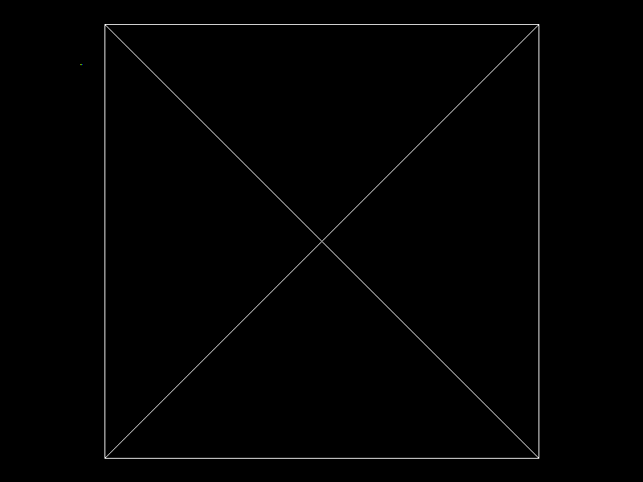

# Proyecto 1 — Parte 2: Rellenando triángulos

Renderer hecho desde cero en Rust. Carga un modelo `.obj`, recorre todos sus triángulos y los dibuja en un framebuffer propio, sin usar las funciones de Raylib para cargar o dibujar modelos 3D. Raylib se usa únicamente para el tipo `Image`/`Color`/`Vector` y para exportar la imagen final.

## Resultado



## Cómo funciona

```
Archivo OBJ -> Vértices + índices -> Triángulos -> Líneas -> Píxeles -> Imagen
```

- `obj.rs`: `load_obj` lee el archivo y devuelve un `Obj` con `vertices: Vec<Vector3>` e `indices: Vec<usize>` (caras trianguladas, índices base 0).
- `triangle.rs`: `draw_triangle` dibuja el contorno de un triángulo con tres líneas.
- `line.rs`: algoritmo de Bresenham.
- `framebuffer.rs`: buffer de píxeles y exportación a imagen.
- `main.rs`: calcula la caja delimitadora del modelo, lo escala y centra usando solo `x` e `y`, y dibuja cada triángulo.

## Cómo ejecutar

```
cargo run --release
```

El modelo se lee de `model/object.obj` y la imagen se guarda en `render.png` en la raíz del proyecto.

## Modelo utilizado

`model/object.obj`

## Algoritmos de rellenado

### Algoritmo 1: Coordenadas baricéntricas

Se basa en calcular un cuadro delimitador (bounding box) alrededor del triángulo y evaluar, para cada píxel dentro de él, si pertenece al interior de la figura usando pesos baricéntricos.

### Algoritmo 2: Lineas horizontales

Avanza una fila a la vez, calcula las intersecciones de la fila con los lados del triángulo y genera fragmentos entre los extremos del tramo interior.


## Resultados del benchmark


| Algoritmo | Mediana de 7 muestras de 100 rasterizaciones | Fragmentos por rasterización |
| --------- | --------------------------------------------- | ---------------------------- |
| Baricéntrico | 851.636097 ms | 129030 |
| Scanline | 680.072074 ms | 129030 |

Las mediciones corresponden a un triángulo grande y dependen del equipo y de la carga del sistema.

## Perfilado

El modo `--benchmark-triangles` rasteriza repetidamente el triángulo y termina sin abrir la ventana. Para medirlo con `cargo-flamegraph` y `perf` instalados:

```bash
cargo flamegraph -- --benchmark-triangles
```

El comando genera `flamegraph.svg` en la raíz del proyecto.

```bash
cargo run --release -- --benchmark-triangles
```
